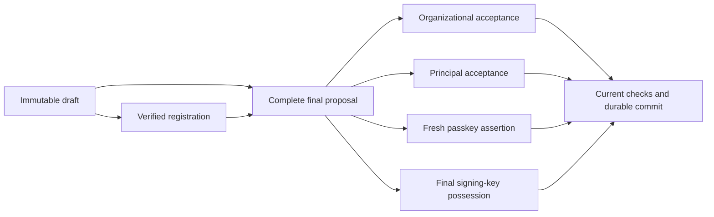

# Initial organization trust

This is the acceptance contract for the first organization administrator and
trusted client. It does not activate an account service, select a production
WebAuthn adapter or turn the coordinator's fixture catalog into organization
trust. The [authority model](TEAM-AUTHORITY.md) governs subsequent operations.

## Who authorizes the beginning

The organization designates who may accept its initial authority through an
existing organizational procedure outside Vivac. Vivac cannot derive that mandate
from an operating-system administrator, a VPN connection, an email address or a
successful login. Infrastructure access is not permission to assign governance,
recovery powers or content access.

The designated authority accepts the initial organization and grants. The first
principal accepts its own signing-device and passkey association. One person may
perform both actions if the organization authorizes that arrangement; the two
actions remain distinct and must bind the same complete proposal. Evidence of a
local verification gesture does not establish the person's organizational role.

The organization keeps any mapping to a natural person in its protected directory.
Vivac's authority evidence uses opaque identifiers. Names, email addresses,
biometrics, PINs and authenticator secrets do not belong in the provenance tree.

## Independently accepted proposal

The initial proposal must bind all of the following before acceptance:

| Area | Required contents |
|---|---|
| Installation | A new organization identifier, protocol/profile version and bootstrap operation identifier. |
| Coordinator | The intended coordinator's authenticated identity and expected endpoint, with the applicable transport trust configuration. |
| First principal | Its opaque identifier and exact first device identifier, signing-credential identifier and public verification key. |
| Passkey | Its opaque user handle, credential identifier, verified public-key descriptor and explicit association with that principal and signing binding. |
| WebAuthn scope | Exact RP identifier, expected origin, required verification policy and accepted registration profile. |
| Authority | Each initial capability, scope and delegation limit, including any enrollment-policy administration. No implicit administrator bundle. |
| Ceremony | Purpose, fresh nonce, issuance and expiry, and registration evidence commitment. The acceptance packet also carries the derived final proposal commitment. |

The final proposal commitment is derived from the complete proposal content.
It accompanies that content in the acceptance packet; it is not an input to
itself. Final evidence identifies the resulting commitment and is retained
alongside the proposal, without becoming part of its own challenge input.

Recovery authority and content-key custody are separate policies. Bootstrap must
state whether either is being established; this contract grants neither. A
principal can exist without permission to read project content. No historical
project audience, recovery custodian or content key is inferred from its creation.

Both the designated authority and first principal must obtain their expected
organization and complete proposal commitment through an independently trusted
organizational channel. A digest displayed only by the synchronization server,
or repeated by a second page from that server, is not an independent expectation.
An unauthenticated first connection is not accepted merely because it is first.

The trusted client verifies the complete commitment and exposes the exact grant
set for review. Comparing a truncated display code alone is insufficient. A change
to any bound field invalidates acceptance and requires a fresh review. Canonical
encoding, signature domains, display/transfer encoding and resource limits require
their own reviewed implementation profile; this document does not define wire
bytes or authorize an ad hoc cryptographic protocol.

## Proposal inputs and acceptance boundaries

The complete packet distinguishes independently expected values from values
observed during registration. Neither group authenticates the other merely by
appearing in the same packet. The trusted client must retain the provenance of
its expectations outside server-controlled proposal data.

| Input | Required source and check |
|---|---|
| Organization and designated accepting authority | An independently authenticated organizational procedure. A claim in the packet, server configuration or the candidate's signature cannot designate that authority. |
| Coordinator identity, endpoint and transport trust | The independently configured expectation for that installation. The packet must match it exactly; server-provided values cannot replace it. A change to a bound identity, endpoint or trust configuration requires separate acceptance under its applicable policy. |
| First principal and signing binding | The exact candidate proof and the independently expected principal and signing binding. The proof establishes possession under its own purpose; it does not establish organizational mandate or final acceptance of the association. |
| Requested initial authority | The explicit grant plan below. A server-side role name or constructor default cannot expand it. |
| Passkey and registration metadata | The retained, validated registration for the exact draft and candidate. An imported descriptor cannot replace that provenance. |
| Final ceremony context | The live reservation created before sealing the proposal, with the original expiry and private deadline retained. Neither acceptance nor a retry renews that window. |
| Final proposal commitment | Recomputed from the complete proposal content, excluding its derived commitment and final evidence, under the reviewed implementation profile. Compare it in full with the independently obtained expectation; a supplied digest alone is insufficient. |

### Explicit initial grant plan

The initial grant plan is part of both the draft and final proposal. Every entry
names the first principal, the exact permission, its organization or resource
scope, and the applicable delegation rule. The plan must distinguish an empty
set from a missing field. Missing, duplicate, contradictory or unsupported
entries refuse; no parser or constructor fills them with an administrator role.

The existing authority vocabulary distinguishes these permissions:

| Permission | Meaning that must remain explicit |
|---|---|
| `ManageMembers` | Membership administration in the named organization. It does not imply content access, enrollment consent or another administrative capability. |
| `ManageProjects` | Project administration in the named organization. Creating a project does not release its content keys. |
| `GrantProjectAccess` | Administration of project permissions under the applicable authority policy. It is distinct from a content grant to the administrator. |
| `ManageOrganizationCapabilities` | Administration of organization capabilities under the selected authority policy. Its delegation powers must be shown and accepted, rather than hidden in an administrator label. |
| `EnrollmentPolicyAdministrator` | Administration of the explicit additional-device policy. It is separate from membership and from the owner's consent to an actual enrollment. |
| `OwnAdditionalDevice` | The first principal's explicit eligibility for that enrollment scope. It is neither another device's admission nor reusable consent. |

These names describe the existing authority model; this table does not grant
them or select their wire representation. A restricted delegation rule that the
admission implementation cannot enforce must refuse, rather than being widened
to its nearest supported role. Project permissions, governance permissions,
content-key custody and recovery authority require their own explicit policy;
none is inferred from this administrative set. Unknown permission classes cannot
be silently omitted from the accepted packet.

The base authority constructor requires an explicit capability set and adds no
default capabilities. This is a model boundary, not evidence that a person
accepted that set. The existing signed fixture profiles retain a fixed
administrative set. Their wrappers are not activation adapters for arbitrary
accepted grants. Before any real
bootstrap can call an authority constructor, the implementation must demonstrate
that its resulting grants and delegation rules equal the accepted plan, including
every explicitly empty set. An unsupported plan refuses before publication.
Equality after dropping unsupported fields is not that check.

### Four separate evidence claims

| Evidence | What must be verified | What it cannot establish |
|---|---|---|
| Organizational acceptance | The independently designated authority accepts the complete proposal and exact grant plan for this installation and operation. | The accepting authority cannot be designated by the synchronization operator or by the act of signing the packet itself. |
| Principal acceptance | The first principal accepts its exact signing-device and passkey association and the complete proposal. | Passkey UV or a device possession signature alone is not acceptance of the association or organizational privileges. |
| Final passkey assertion | Fresh UP and UV, the exact registered key and the proposal-bound challenge, within the retained ceremony window. | It does not confer organizational mandate, content access or recovery powers. |
| Final signing-device proof | A new purpose-bound signature for the same complete proposal by the exact candidate signing key. | The earlier candidate signature and an organizational acceptance cannot substitute for this proof. |

The four claims may concern the same person and keys where an accredited profile
allows it, but remain distinct actions and evidence. An implementation profile
must identify the verifier and independently established trust input for each
acceptance claim. It must not invent an organizational verification key from the
candidate key, the TLS certificate or a successful login. No such key or
acceptance signature format is selected here.

Constructing a complete packet, displaying its digest or checking its possession
evidence leaves it unaccepted until both acceptance claims are established.
Caller-supplied `approved`, `reviewed` or `verified` flags cannot cross this
boundary. Test-only acceptance fixtures must remain visibly separate from live
authorization capabilities and cannot be deserialized into them.

A change to a bound value invalidates both acceptances and both final possession
proofs. The implementation must refuse mixtures of otherwise valid evidence from
different proposals, organizations, operations or contexts. Expired evidence
cannot be refreshed by updating a timestamp in the packet. These checks precede
the current-authority, uniqueness and durable-admission checks; passing them does
not replace those later checks.

## Separate evidence for separate claims

The client must have independently verifiable distribution and update provenance,
as required by the [client trust boundary](TEAM-AUTHORITY.md#trusted-clients-and-recovery).
Synchronization-server JavaScript cannot become trusted merely by displaying a
review screen. The chosen real client, platform WebAuthn adapter, RP identifier,
origin and HTTPS trust must be demonstrated together. A native API accepting an
RP string, a loopback page or a remote browser is not by itself that demonstration.
No particular adapter or hostname is selected by this contract. Locally trusted
certificates may be used; a paid certificate is not a prerequisite.

Registration and authentication are distinct checks. The registration verifier
must follow the applicable [WebAuthn registration procedure](https://www.w3.org/TR/webauthn-3/#sctn-registering-a-new-credential),
including challenge, origin, RP binding, required user verification, credential
uniqueness and public-key validation. A later assertion with the newly registered
credential must bind the final proposal, including its registration evidence.
That assertion must verify user presence and fresh user verification. The first
device must separately prove possession of its signing key over the same proposal.
Registration success alone is not the final authorization or proof that the
organization assigned those privileges.

[WebAuthn user verification](https://www.w3.org/TR/webauthn-3/#user-verification)
does not establish a civil or organizational identity. Attestation policy must
state which authenticator properties it establishes. Accepting no attestation
cannot be described as hardware provenance, a nonexportable key or proof that
only one natural person can use the authenticator. Synthetic UV flags remain
test evidence rather than accreditation of a real human ceremony.

The [format-5 public descriptor](ATOMIC-DEVICE-ADMISSION.md#bootstrap-and-state)
is not a registration importer. Its fixture constructor rejects metadata outside
its commitment. A real registration profile must explicitly retain, validate or
reject each supported metadata field and account for it in replay and trust
commitments. Clearing AAGUID, attestation or extension metadata to make a result
fit the fixture constructor is forbidden. The registration profile must also
specify its initial counter and backup state, the policy requiring fresh
verification at the next assertion, and any further state actually required by
the pinned verifier. These requirements cannot be inferred from a successful
login or silently reset during replay; they do not require inventing a library
initialization flag.

The separate [registration profile](PASSKEY-REGISTRATION.md) evaluates strict
parsing and explicit public metadata in the isolated coordinator probe. Its
unconfirmed result is not an admitted passkey association or a bootstrap.

## From registration draft to final proposal

The commitment supplied before credential creation cannot already include the
result of that creation. The ceremony therefore distinguishes a registration
draft, registration evidence and the final proposal. The labels below describe
dependencies, not wire fields, hash domains or a new cryptographic format.

| Stage | Inputs fixed at this stage | Result and permitted claim |
|---|---|---|
| Draft | Intended organization and coordinator, first principal and signing binding, candidate possession proof, requested grants, RP/origin, registration profile, operation identity and applicable validity limits. | An immutable draft commitment. It establishes the scope of registration, not organizational acceptance. |
| Registration | That exact draft commitment and candidate proof, with the configured registration verifier and its private pending state. | Verified registration evidence, its commitment and complete public descriptor. The credential remains unconfirmed. |
| Final proposal | The same draft, its commitment, the verified registration evidence and descriptor, and the final ceremony's purpose and bounded context. | One complete immutable proposal for independent comparison and final acceptance. |
| Final evidence | That exact final proposal, the designated organizational authority and first principal, the new passkey and first signing device. | Separate organizational acceptance, principal acceptance, fresh WebAuthn assertion and signing-key possession evidence. None alone activates authority. |
| Admission | All final evidence, current authority and uniqueness checks, and the durable transition. | A committed association and explicit grants, or no admitted bootstrap effects. |

The registration helper's `review` input binds the draft stage. The helper does
not construct that draft or validate its business contents. Calling this input
a review commitment does not prove review, acceptance or a final proposal.
Likewise, its unconfirmed result does not validate the authority or uniqueness
checks needed at admission.

The final proposal includes every area in the independently accepted proposal
table above. It adds the exact credential and public metadata learned during
registration and the registration evidence commitment. The descriptor must be
the one derived by the accredited registration verifier from that evidence;
an independently supplied descriptor or a shortened metadata projection cannot
replace it. Content access, recovery and key custody remain explicit separate
policies, with no grants inferred from successful credential creation.

The dependency order is:

The device's earlier candidate proof remains evidence for its original
challenge. That challenge does not include the registration result, so its
signature cannot be reused as signing-key possession over the final proposal.
The signing device must produce purpose-bound evidence over that complete
proposal after it is fixed. The later passkey assertion must bind the same
proposal, including its registration evidence, and require fresh UP and UV.
It must verify with the exact credential and key from that registration, not a
replacement supplied by the caller. That result establishes scoped possession,
not organizational membership or initial authority.
These checks remain separate even when one person supplies all of them.

Final assertion bytes and final signing evidence are produced from the fixed
proposal; they are not inputs that the same proposal's commitment must predict.
Similarly, the proposal fixes the registration's verified starting counter and
backup state, together with the applicable assertion policy. A reviewed
composition profile must specify the exact state required by its pinned verifier
before sealing the proposal. Passki 0.5.0 does not use an additional persisted
user-verification initialization flag. The composition must not invent one or
interpret registration-time UV as permission to skip fresh UV later. Any future
verifier with different state requirements needs a reviewed mapping, not defaults
borrowed from another implementation.
The verified successor state and accepted-time claim are
outputs retained with the admission evidence. They must not be inserted back
into the already accepted proposal or silently reset to fixture defaults.
The future implementation profile must define and verify those transitions.

## State and purpose of the final assertion

The [registration state contract](PASSKEY-REGISTRATION.md#state-for-a-later-assertion)
defines the initial public state and its provenance. That state is used only for
the exact credential, signing binding and principal named in the final proposal.
A descriptor supplied separately by the caller cannot replace the verified
registration result. The helper's [experimental possession profile](FINAL-PROPOSAL-PROBE.md)
retains live, single-use confirmation state and binds an opaque proposal
commitment to a fresh assertion and signing-key proof. It does not validate the
complete business proposal, organizational acceptance or authority. Reading a
descriptor does not create a live confirmation capability.

The future confirmation operation must bind the complete final proposal
commitment, registration evidence commitment and profile, candidate identity and
signing binding, organization and principal, exact credential and key, RP/origin,
verification policy, operation purpose and bounded ceremony context. These are
semantic inputs; this contract selects no encoding, signature domain or durable
record format. An enrollment or additional-device assertion cannot satisfy this
different purpose merely by carrying the same identifiers.

Any ceremony purpose, nonce and validity context included in the final proposal
must be fixed before that proposal is sealed. Reserving this context does not
accept the proposal or create authority. Issuing the final assertion request
cannot introduce a new value that the already accepted proposal was meant to
bind; changing a bound context requires a new proposal and review.

Before starting the final assertion, all required state must be derived and
checked against the retained registration and frozen proposal. The pending state
must retain that exact scope and deadline privately. Finishing consumes it,
rechecks the scope and validity, and verifies a fresh assertion under the same
credential with required UP and UV. A decoded packet, client-supplied approval
flag or saved assertion cannot mint this pending capability.

Successful verification produces evidence of key possession for that proposal
and the verified successor state. It grants no membership, delegation, content
access or recovery role. Organizational acceptance and the first device's final
signing evidence must still be checked separately against the same proposal.
The successor remains part of the pending operation until the complete durable
admission commits; it must not update an admitted credential or consume a second
authorization independently.

| State or input variation | Required result |
|---|---|
| Final proposal, registration evidence, principal, signing binding, credential, key or RP/origin differs from pending state | Refuse; no fallback to a supplied key or another credential. |
| Assertion was issued for enrollment, an additional device or another final proposal | Refuse the purpose mismatch. |
| Registration observed UV but the final assertion lacks fresh UP or UV | Refuse; registration is not a reusable user-verification session. |
| Request permits an empty or broader credential selection | Refuse this profile; only the exact registered credential is eligible. |
| A returned user handle differs from the retained expected handle | Refuse; an absent handle is acceptable only under the exact-credential request contract. |
| Counter is unchanged or decreases, except when both values are zero | Refuse according to the pinned verifier's counter policy; do not fabricate an increment. |
| Backup eligibility changes, or backup state is set without eligibility | Refuse; retain a backup-state change only after the complete assertion verifies. |
| Caller substitutes a default or a state imported from another verifier/profile | Refuse; state mapping requires its own reviewed profile. |
| Pending state is reused, reconstructed after restart or extended past the original deadline | Refuse; a successful verification is not renewed authorization. |

## Validity and failure boundaries between stages

Each stage keeps the original operation identity and its links to the preceding
evidence. Changing any draft input invalidates that draft and its registration
evidence; it requires a fresh ceremony. Changing the final proposal invalidates
all final acceptance and possession evidence. A new nonce, later assertion or
retry cannot renew an earlier expired proof or registration window.

The live coordinator must carry a bounded private deadline across stages and
recheck applicable wall-clock windows, current authority and the expected store
state before committing. Reconstructing public timestamps, decoding a retained
record or restarting the process does not restore a live pending capability.
The current registration result does not provide this outer ceremony state.

Refusal or abandonment creates no admitted organization, association, signing
binding or grant. It is not evidence that authenticator-local material was
deleted. Such cleanup requires a separately supported procedure; neither a
failed authority transaction nor a lost server response proves that deletion.
After an uncertain commit, reconciliation must determine the original durable
outcome before any new attempt. It must not run final verification again to
manufacture a different result or consume an authorization twice.

| Composition attempt | Required rejection or result |
|---|---|
| Supply a final-proposal commitment as a registration input even though it depends on that registration's future result | Refuse the circular construction; draft and final proposal are distinct stages. |
| Pair a valid registration with another draft, candidate, principal, coordinator or RP/origin | Refuse; each link must agree with the retained registration scope. |
| Reuse the candidate signature as final signing-key confirmation | Refuse; it does not cover the complete final proposal. |
| Present a valid final assertion for another proposal or omit the final signing evidence | Refuse admission. |
| Replace, omit or reset a registration metadata field after review | Refuse; no conversion through a fixture constructor repairs the mismatch. |
| Counter or backup state advances through the final assertion | Retain only the verified transition from the exact registration state; do not reinterpret the result as a new proposal input. |
| A proof expires, authority changes or an identifier conflicts before commit | Refuse the stale or conflicting attempt, with no partial admission. |
| Restart after registration without a committed operation | Refuse restoration of live authorization from an archive; no automatic grant or renewed window. |
| Retry after the operation already committed | Reconcile the exact existing result under current access authority, without a second assertion or state advance. |

The existing enrollment and additional-device assertion scopes require their
own trusted binding and purpose. They cannot be relabeled as bootstrap evidence
for an unconfirmed credential. A future implementation needs a reviewed scope,
state representation and result type that preserve the complete registration
profile without creating authority merely by constructing a binding.

This stage contract does not select canonical bytes, signature domains, a real
client adapter or a durable bootstrap format. Those choices and their rejection
vectors require review against current-authority, revocation and recovery
requirements before implementation. The isolated browser registration tests
establish none of those prerequisites by themselves.

## Durable activation

Bootstrap applies only to a new authority store. An existing, restored, revoked
or conflicting organization does not become new by deleting a pending ceremony.
Unverifiable state refuses; recovery remains the separately authorized procedure.

The accepted evidence must commit the organization, first active principal,
signing binding, passkey association, explicit initial grants and consumed
bootstrap authorization in one durable transition. An acknowledgment must follow
that commit. Failure before commit leaves none of those effects admitted. Lost
acknowledgment requires reconciliation against the original complete operation;
retrying cannot renew acceptance, change grants or consume the passkey again.
Reconciliation is subject to current access authority.

Both trusted client and coordinator retain the accepted initial checkpoint and
its public verification evidence. Their trust does not come from a second copy
of a server-provided digest. A new client needs authenticated onboarding and a
current independently accepted checkpoint. A backup alone is not evidence of
current authority. A coordinator remains trusted for online ordering and access
checks; the initial packet does not provide Byzantine consensus or detect every
fork presented to an isolated client.

Registration evidence, raw assertions and public authority records belong in the
explicitly governed authority store, with appropriate access controls and bounded
retention. The work-provenance tree receives references and decisions only. No
private signing key, authenticator secret or content key is sent to the
synchronization operator. Content keys remain with authorized trusted clients or
explicitly designated recovery custodians under their separate policy.

## Rejection and accreditation criteria

| Scenario | Required result |
|---|---|
| The operator claims to be the first administrator without organizational acceptance | Refuse; infrastructure access grants no initial authority. |
| The only expected fingerprint comes from the synchronization server | Refuse initial trust. |
| Organization, coordinator, RP/origin, key, association or grant changes after review | Refuse; all acceptance and possession evidence must bind the final proposal. |
| Registration is valid but the final assertion or signing possession proof is absent | Refuse activation. |
| User verification is missing, replayed, expired or obtained for another purpose | Refuse activation without partial grants. |
| Credential identifiers or public signing bindings conflict with retained state | Refuse; never replace an existing binding implicitly. |
| The registration contains metadata outside its accredited profile | Refuse rather than discard it. |
| A crash occurs before commit | Reopen with no admitted bootstrap effects. |
| Commit succeeded but the response was lost | Reconcile the exact original result without renewed permission or counter changes. |
| Bootstrap is attempted again after activation or from a stale backup | Refuse a new bootstrap; use authorized onboarding or recovery. |
| A client cannot authenticate the coordinator or demonstrate the expected WebAuthn scope | Refuse activation; local capture remains available. |

Machine checks must exercise those rejection and crash boundaries with bounded
inputs and independent vectors. They do not replace a real person's review of
the trusted-client display or the demonstration of actual user verification on
the supported platforms. Before implementing that display, record what the
person learns from it and obtain human judgment of the exact surface. Every
operation must have a CLI contract before a web interface is exposed.

Ordinary capture remains local and does not wait for this ceremony. Production
activation requires an accredited client/registration profile, a reviewed durable
bootstrap format, measured resource limits and the applicable cross-platform
verification. Neither the existing fixtures nor this contract satisfy those
requirements by themselves.
